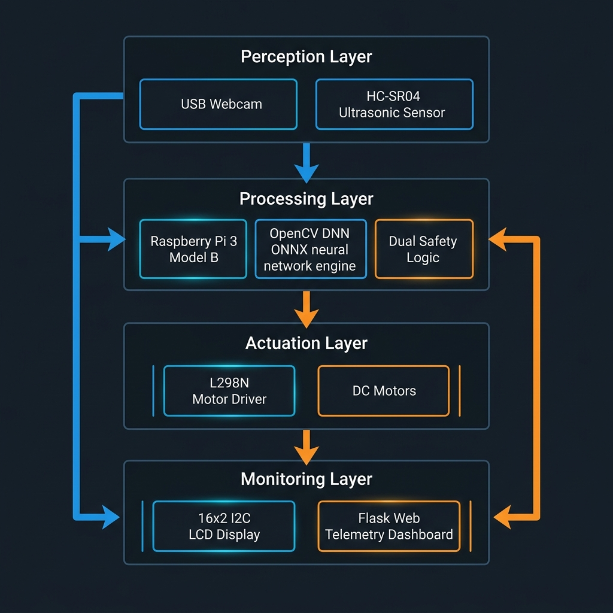
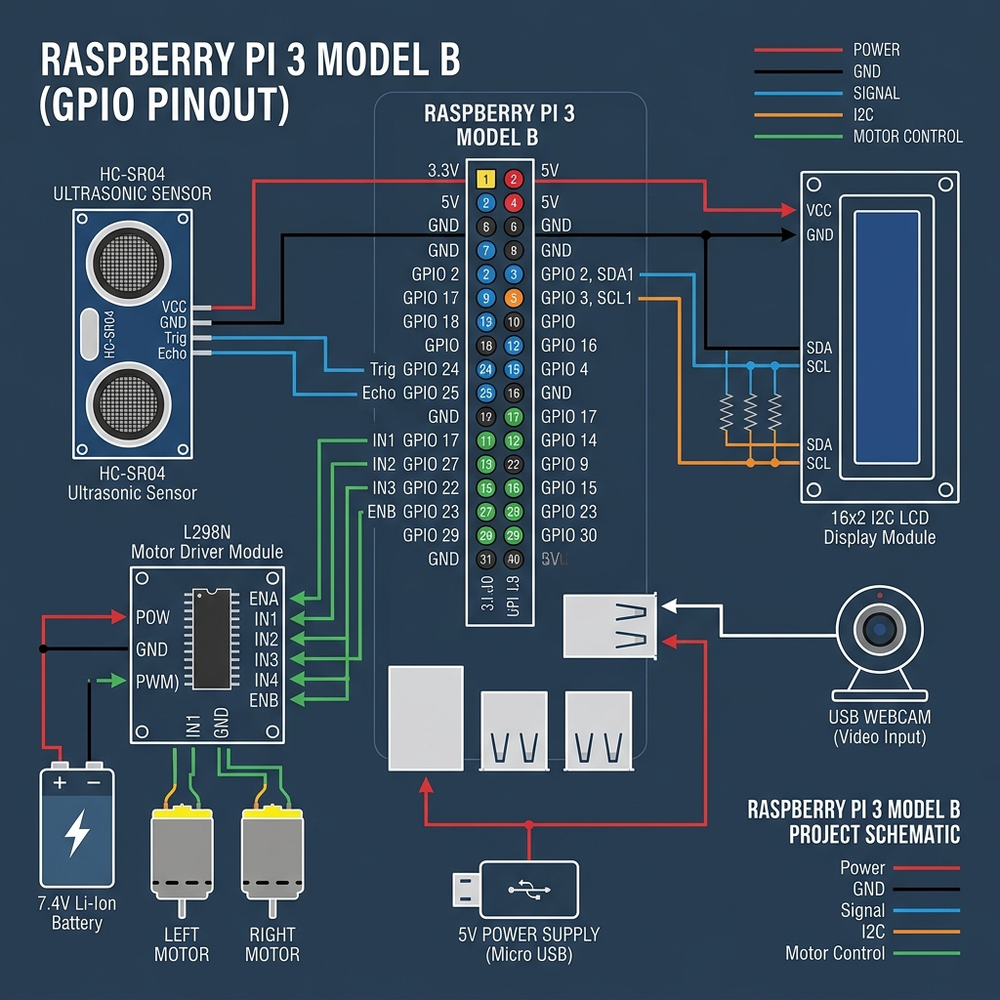
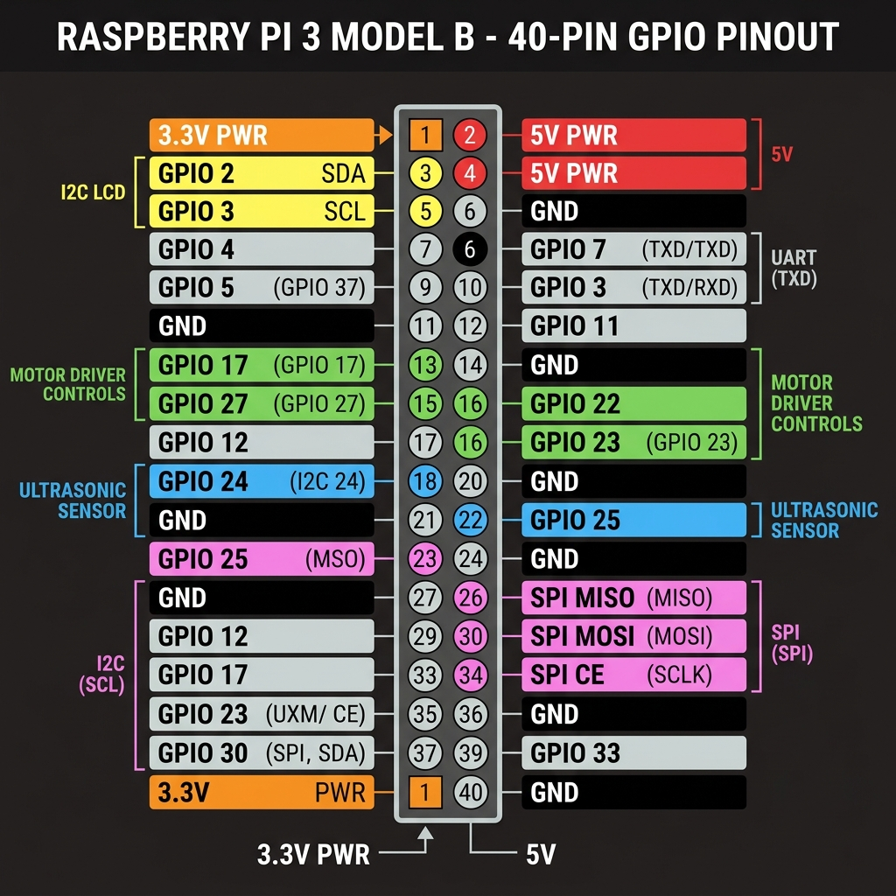

# Raspberry Pi Autonomous Rover

An autonomous vision-guided rover platform built on the Raspberry Pi 3 Model B. The rover combines real-time vision inference using Google Teachable Machine models in ONNX format with OpenCV Deep Neural Networks (DNN), an HC-SR04 ultrasonic distance sensor hardware fail-safe, an I2C 16x2 LCD status display, a web dashboard powered by Flask for live streaming and telemetry, and automatic startup via systemd.

## Table of Contents

- [Overview](#overview)
- [System Architecture](#system-architecture)
- [Hardware Components](#hardware-components)
- [Circuit Pinout and Connection Diagrams](#circuit-pinout-and-connection-diagrams)
- [Software Requirements](#software-requirements)
- [Project File Structure](#project-file-structure)
- [Setup and Installation](#setup-and-installation)
- [Systemd Autostart Configuration](#systemd-autostart-configuration)
- [Desktop Live Log Monitoring](#desktop-live-log-monitoring)
- [Web Telemetry Dashboard](#web-telemetry-dashboard)
- [Operational Logic](#operational-logic)
- [License](#license)

---

## Overview

The Raspberry Pi Autonomous Rover is designed for dual-layer safe autonomous navigation:
1. Visual Path Perception: A USB camera captures live video frames, preprocessed to 224x224 RGB and passed into an ONNX classification model via OpenCV DNN module to determine if the forward path is clear (`Path`) or blocked (`Obstacle`).
2. Hardware Proximity Safety Override: An HC-SR04 ultrasonic sensor continuously measures distance to physical obstacles in real time. If an object comes within 20 cm, a hardware safety override immediately halts forward motion and triggers an evasive turn maneuver regardless of visual prediction.
3. Live Monitoring and Controls: Built-in I2C 16x2 LCD display provides local hardware feedback, while a Flask web server provides remote live streaming, start/stop control, photo capture, video recording, and a media gallery interface.

---

## System Architecture

The overall system architecture is organized into four interconnected operational layers:




### Layer Specifications

1. Perception Layer:
   - USB Webcam: Captures video frames for real-time scene classification.
   - HC-SR04 Ultrasonic Sensor: Measures distance in centimeters using trigger (GPIO 24) and echo (GPIO 25) signals.

2. Processing Layer:
   - OpenCV DNN Engine: Loads `model.onnx` and processes normalized camera tensors (224x224, pixel scaling `(x / 127.5) - 1.0`).
   - Control Thread: Runs concurrently with the web server, evaluating ultrasonic distance and model confidence against safety thresholds (`OBSTACLE_THRESHOLD = 0.20m`, `CONFIDENCE_THRESHOLD = 0.70`).

3. Actuation Layer:
   - L298N Dual H-Bridge Driver: Controls two DC motors.
   - Left Motor Pins: GPIO 17, GPIO 27.
   - Right Motor Pins: GPIO 22, GPIO 23.

4. Monitoring Layer:
   - 16x2 I2C LCD Display: Displays network connection status, IP address, rover operational state, model confidence, and measured distance.
   - Flask Web Server: Serves live stream at port 5000 (`/video_feed`), status JSON endpoint (`/status`), start/stop controls (`/start_rover`, `/stop_rover`), media capture endpoints (`/capture_photo`, `/start_recording`, `/stop_recording`), and gallery management (`/gallery`, `/download/<filename>`, `/delete/<filename>`).

---

## Hardware Components

- Raspberry Pi 3 Model B
- USB Webcam
- HC-SR04 Ultrasonic Distance Sensor
- 16x2 I2C LCD Display Module (PCF8574 I2C adapter, default address 0x3F or 0x27)
- L298N Motor Driver Module
- 2x DC Geared Motors with Robot Chassis
- Power Supply (Separate power sources for Pi and motor driver recommended)
- Jumper Wires and Breadboard / Mounting Board

---

## Circuit Pinout and Connection Diagrams

### GPIO Wiring Summary

| Component | Pin Function | Raspberry Pi 3B Connection |
|-----------|--------------|----------------------------|
| HC-SR04 Ultrasonic | Trigger | GPIO 24 (Physical Pin 18) |
| HC-SR04 Ultrasonic | Echo | GPIO 25 (Physical Pin 22) |
| L298N Motor Driver | Left Motor In1 | GPIO 17 (Physical Pin 11) |
| L298N Motor Driver | Left Motor In2 | GPIO 27 (Physical Pin 13) |
| L298N Motor Driver | Right Motor In3 | GPIO 22 (Physical Pin 15) |
| L298N Motor Driver | Right Motor In4 | GPIO 23 (Physical Pin 16) |
| 16x2 I2C LCD Display | SDA | GPIO 2 / SDA1 (Physical Pin 3) |
| 16x2 I2C LCD Display | SCL | GPIO 3 / SCL1 (Physical Pin 5) |
| USB Webcam | USB Data | USB Port |

### Connection Diagram



### Raspberry Pi 3 Model B Pinout Diagram



---

## Software Requirements

- Raspberry Pi OS (32-bit or 64-bit)
- Python 3.7+
- Python Packages:
  - `opencv-python` (OpenCV with DNN module support)
  - `numpy`
  - `Flask`
  - `gpiozero`
  - `smbus2`

All dependencies are specified in `requirements.txt`.

---

## Project File Structure

```
raspberry-pi-autonomous-rover/
|-- rover.py                 # Main control script (Flask server, CV DNN, Threading, Hardware)
|-- labels.txt               # Class labels file (0 Obstacle, 1 Path)
|-- model.onnx               # ONNX vision model exported from Teachable Machine
|-- rover.service            # Systemd service unit file for auto-boot execution
|-- rover-status.desktop     # Desktop autostart shortcut for live terminal monitoring
|-- requirements.txt         # Python package dependencies
|-- LICENSE                  # MIT Open Source License
|-- README.md                # Project documentation
|-- Rover/                   # Directory created at runtime for photos and videos
`-- docs/
    `-- images/
        |-- system_architecture_diagram.jpg
        |-- connection_diagram.jpg
        `-- rpi3_pinout_diagram.jpg
```

---

## Setup and Installation

### 1. Clone the Repository

```bash
git clone https://github.com/your-username/raspberry-pi-autonomous-rover.git
cd raspberry-pi-autonomous-rover
```

### 2. Enable I2C and Camera Interfaces

Open the Raspberry Pi configuration tool:

```bash
sudo raspi-config
```

Navigate to `Interfacing Options`, enable `I2C`, and enable `Camera` (if using Pi Camera module or standard V4L2 USB camera). Reboot the Pi:

```bash
sudo reboot
```

### 3. Install Python Dependencies

```bash
pip3 install -r requirements.txt
```

### 4. Model Preparation

Train a model on Google Teachable Machine with two classes:
- Class 0: `Obstacle`
- Class 1: `Path`

Export the model in ONNX format as `model.onnx` and ensure `labels.txt` contains:
```
0 Obstacle
1 Path
```
Place both `model.onnx` and `labels.txt` in the root directory of the project.

### 5. Running Manually

```bash
python3 rover.py
```

Access the Web Dashboard by navigating to `http://<RASPBERRY_PI_IP>:5000` in a web browser.

---

## Systemd Autostart Configuration

To configure the rover software to launch automatically upon booting the Raspberry Pi:

1. Copy `rover.service` to the systemd system directory:
```bash
sudo cp rover.service /etc/systemd/system/
```

2. Reload systemd daemon, enable, and start the service:
```bash
sudo systemctl daemon-reload
sudo systemctl enable rover.service
sudo systemctl start rover.service
```

3. Manage the background service:
```bash
# Check service status
sudo systemctl status rover.service

# Stop service
sudo systemctl stop rover.service

# View live journal logs
journalctl -u rover.service -f
```

---

## Desktop Live Log Monitoring

To automatically open a terminal window displaying live log output whenever a user logs into the Raspberry Pi Desktop GUI:

1. Create the autostart directory if it does not exist:
```bash
mkdir -p /home/rpi/.config/autostart
```

2. Copy the desktop autostart entry:
```bash
cp rover-status.desktop /home/rpi/.config/autostart/
```

---

## Web Telemetry Dashboard

The Flask web application provides:
- Live MJPEG Camera Feed at `/video_feed`
- Telemetry Updates at `/status` (Current Action, Vision Class, Confidence Score, Distance)
- Start / Stop Autonomous Navigation buttons
- Photo Capture saved to `Rover/photo_YYYYMMDD_HHMMSS.jpg`
- Video Recording saved to `Rover/video_YYYYMMDD_HHMMSS.avi`
- Media Gallery at `/gallery` with download and delete capabilities

---

## Operational Logic

1. Startup: System initializes hardware interfaces, displays IP address on the 16x2 LCD, loads `model.onnx`, and enters `STANDBY` mode.
2. Inference Loop: Captures camera frames and measures distance every 50 ms.
3. Standby Mode: Stream feed and update web telemetry; motors remain stopped.
4. Active Mode:
   - Distance <= 20 cm: Ultrasonic hardware override triggers immediate `avoid_obstacle()` maneuver (backwards turn).
   - Distance > 20 cm & Class 1 (`Path`) & Confidence >= 70%: Rover moves forward (`PATH -> FWD`).
   - Distance > 20 cm & Class 0 (`Obstacle`): Triggers `avoid_obstacle()` maneuver (`VISION OBSTACLE`).
   - Low Confidence (< 70%): Motors stop (`LOW CONFIDENCE`).

---

## License

This project is licensed under the [MIT License](LICENSE).
